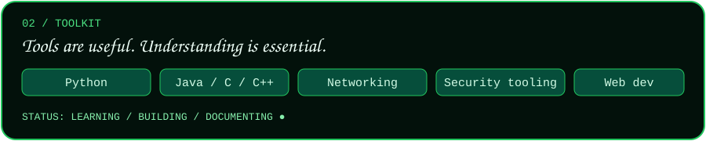
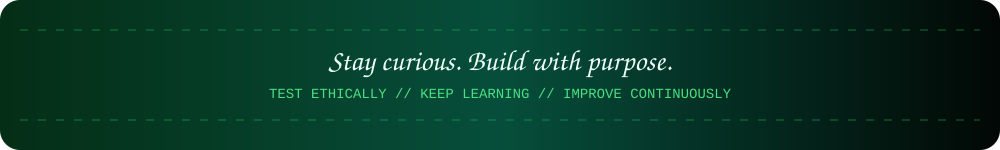

<code>[ 01 // WHOAMI ]</code>
OPERATOR: Bhuvanesh Kumar
EDUCATION: B.Sc. Computer Science
MISSION: Professional Penetration Tester
CURRENT MODE: Learn · Build · Test · Document

I’m a computer science graduate interested in programming, networking, full-stack development, and ethical hacking. I enjoy learning by building practical tools and exploring how applications and networks work.
┌─[ PROFILE / SUMMARY ]─────────────────────────────────────────┐
│  > CODE     : Python · Java · C · C++ · Full-stack development │
│  > SYSTEMS  : Networking · IP addressing · Ports · Protocols   │
│  > SECURITY : Reconnaissance · Security tools · Ethical hacking │
│  > OBJECTIVE: Grow into a professional penetration tester      │
└────────────────────────────────────────────────────────────────┘
Operating principle: Understand the system → test only within scope → validate evidence → document clearly → help improve security.

<code>[ 02 // SKILL MATRIX ]</code>

<code>DOMAIN</code>	<code>TOOLKIT / INTERESTS</code>
LANGUAGES	Python · Java · C · C++
WEB	Full-stack development · HTML · CSS · JavaScript
CYBERSECURITY	Ethical hacking · Reconnaissance · Security tooling
NETWORKING	Subnetting · CIDR · IPv4/IPv6 · Ports · Protocols
WORKFLOW	Git · GitHub · Documentation · Structured problem-solving

These are my current skills and learning interests—not a claim of mastery or professional certification. I’m continuously developing them through practice and projects.

<code>[ 03 // PROJECTS UNDER THE LENS ]</code>
SELECT * FROM projects WHERE status = "building";

The repositories below reflect my interests in security automation, password/hash analysis, modular tooling, and networking. For exact features, usage, and current status, visit each repository.
<table>
<tr>
<td width="50%" valign="top">

<h3><code>01 / RECON_2_EXPLOIT</code></h3>

Reconnaissance & assessment workflow
A project focused on reconnaissance and organizing security-assessment steps.
ATTACK SURFACE AUDITING
CVE INTELLIGENCE REPORTING
Learning focus: collect and organize assessment information before deeper authorized testing.
</td>
<td width="50%" valign="top">

<h3><code>02 / CYBERHASH</code></h3>

Hash & password-security CLI
A Python command-line project for exploring hash analysis and password-security concepts.
DICTIONARY / MASK RULE MUTATIONS
MULTITHREADING BENCHMARKS SESSIONS
Learning focus: scripting, command-line workflows, and performance considerations.
</td>
</tr>
<tr>
<td width="50%" valign="top">

<h3><code>03 / CYBER-FRAMEWORK</code></h3>

Modular cybersecurity CLI
A security-tooling project exploring module discovery, intelligence workflows, and an interactive console.
CLI MODULAR DESIGN
INTELLIGENCE AUTOMATION
Learning focus: reusable components and structured command-line workflows.
</td>
<td width="50%" valign="top">

<h3><code>04 / NETFORGE</code></h3>

Browser-based network toolkit
A network engineering toolkit for practical calculations and quick-reference tasks.
SUBNETTING CIDR / VLSM
IPv4 / IPv6 MAC ANALYSIS
PORTS / PROTOCOLS CISCO ACLs
Learning focus: build a stronger foundation in how systems communicate.
</td>
</tr>
<tr>
<td colspan="2" valign="top">

<h3><code>05 / SECURITY_TOOL_PRACTISE</code></h3>

Hands-on security practice
A practice-oriented repository for exploring security tools and reinforcing foundational concepts through exercises.
PRACTICE FOUNDATIONS HANDS-ON LEARNING
</td>
</tr>
</table>

<code>[ 04 // LEARNING ROADMAP ]</code>

[ COMPLETE ]  Build programming fundamentals
[ ACTIVE   ]  Practice Python and networking utilities
[ ACTIVE   ]  Explore security tools and assessment workflows
[ NEXT     ]  Strengthen web application and network testing skills
[ TARGET   ]  Become a professional penetration tester
I’m focused on consistent hands-on learning, documenting what I build, and improving the quality and clarity of my projects. Security testing should always be performed with clear authorization and a defined scope.

<code>[ 05 // CONNECT ]</code>

<code>SESSION STATUS: LEARNING IN PROGRESS // BUILT WITH CURIOSITY & CONSISTENCY</code>

